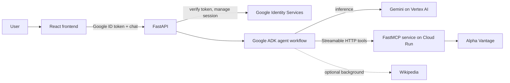

# FinMarket Intelligence

I’ll summarize the current workspace rather than relying on earlier layout assumptions. I’ll check the active README, backend entrypoints, MCP implementation, frontend, and root build/dependency files; I’ll avoid repeating any values from `.env`.

Read 

Read 

Read 

Read 

Read 

Read 

Read 

**Architecture**

The API verifies Google ID tokens server-side, permits verified Gmail accounts, and associates ADK sessions with each user. The agent researches with MCP tools and optional Wikipedia context, then formats a response. Wikipedia failures are handled as optional context so they don’t abort the workflow.

**Tech Stack**
- Frontend: React 19, TypeScript, Vite, Google Identity Services, React Markdown with GFM tables.
- Backend: Python 3.13, FastAPI, Google ADK, Google Auth, FastMCP, HTTPX.
- Model and data: Gemini on Vertex AI, Alpha Vantage, Wikipedia.
- Deployment: One multi-stage Docker image builds the UI and backend; Cloud Run runs it as two services, with different commands for the API and MCP server. Dependencies are managed with `uv` and npm lockfiles.
- Google login is implemented is active on Cloud Run.

